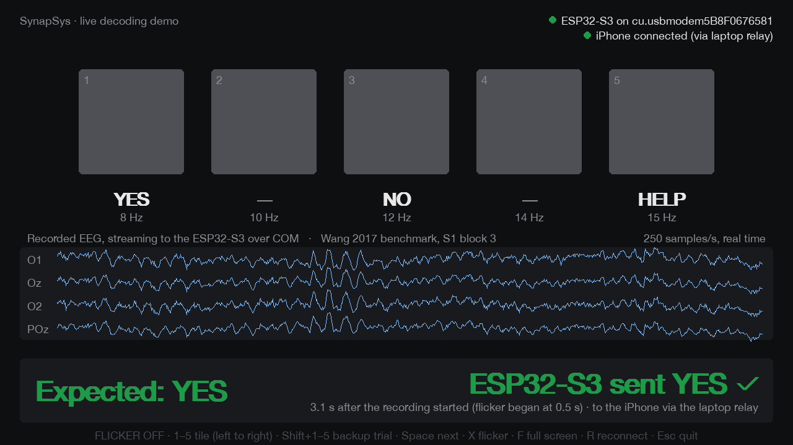
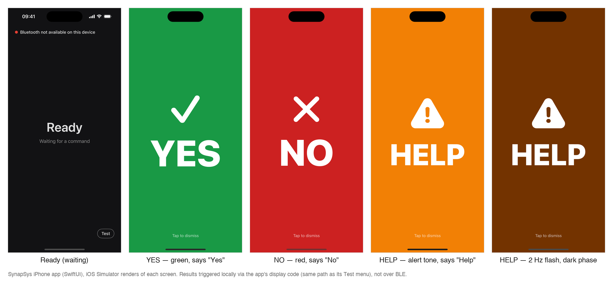

# SynapSys

**SynapSys is a brain–computer interface that lets a person answer YES, NO or HELP just by
looking.** Three targets on a screen flicker at different rates. Looking at one makes the
visual cortex fire at that same rate: a *steady-state visually evoked potential* (SSVEP).
Four EEG electrodes at the back of the head pick this up. A small ESP32-S3 board works out
which rate it is and sends the answer over Bluetooth to a phone, which shows and speaks it.

```
  screen                    head                      ESP32-S3 board                    phone
┌──────────────┐     ┌──────────────────┐     ┌────────────────────────────┐     ┌─────────────┐
│ YES   8.57 Hz│ ──► │ 4 EEG electrodes │ ──► │ filter → CCA → decide      │ ──► │ shows and   │
│ NO   12 Hz   │ eye │ (O1, Oz, O2, POz)│ ADS │ every 0.5 s, ~4.5 ms each  │ BLE │ speaks YES  │
│ HELP 15 Hz   │     │ 250 samples/s    │ 1299│                            │     │             │
└──────────────┘     └──────────────────┘     └────────────────────────────┘     └─────────────┘
  stimulus/                                     src/ (Python reference)           live_demo/ios/
                                                firmware/ (C++ on the chip)
```

This repository holds all of the software: the flickering interface, the signal-processing
decoder (in Python and C++), the ESP32-S3 firmware, and a live end-to-end demo with an
iPhone app.

> SynapSys is a student senior-design prototype. It is not a medical device.

---

## Contents

1. [What is in this repository](#what-is-in-this-repository)
2. [How the decoder works](#how-the-decoder-works)
3. [Setup (once)](#setup-once)
4. [Run it](#run-it)
   - [A. Run the tests](#a-run-the-tests)
   - [B. Decode real brain data (Wang 2017 dataset)](#b-decode-real-brain-data-wang-2017-dataset)
   - [C. The flickering interface](#c-the-flickering-interface)
   - [D. The live demo (laptop → ESP32-S3 → iPhone)](#d-the-live-demo-laptop--esp32-s3--iphone)
   - [E. The firmware without a board](#e-the-firmware-without-a-board)
5. [Folder structure](#folder-structure)
6. [Results so far](#results-so-far)
7. [Rules for contributors](#rules-for-contributors)

---

## What is in this repository

| Part | Folder | Language | What it does |
|---|---|---|---|
| **Flickering interface** | `stimulus/` | Python (PsychoPy) | Draws the YES / NO / HELP targets, each flickering at its own exact rate on a 60 Hz screen. |
| **Reference decoder** | `src/synapsys_decoder/` | Python | The algorithm, written clearly and tested. It is the "source of truth" that everything else must match. |
| **On-chip decoder** | `firmware/decoder/` | C++17 | The same algorithm rewritten to run on a microcontroller. Tested to give the same answers as Python. |
| **Board firmware** | `firmware/esp32/` | C/C++ (ESP-IDF) | Runs on the ESP32-S3: reads the EEG chip (ADS1299), runs the decoder, sends commands over Bluetooth. |
| **Live demo** | `live_demo/` | Python, Swift | Plays recorded EEG from the laptop into the real board in real time; the board's answer appears on an iPhone app. |
| **Scripts** | `scripts/` | Python | Download data, run validations, record and calibrate, compare chip vs Python. |

---

## How the decoder works

Every 0.5 s the decoder looks at the last 2.5 s of EEG (625 samples × 4 channels) and asks:
*"which flicker rate is in this signal?"*

| Step | What happens | Why |
|---|---|---|
| 1. Remove DC | Subtract each channel's average | Electrodes add a large constant offset |
| 2. Band-pass filter 0.5–45 Hz | 4th-order Butterworth, run as 4 "biquad" stages | Removes slow drift and high-frequency noise / muscle activity |
| 3. Notch 60 Hz | One biquad | Removes mains hum (off for the 50 Hz Wang dataset) |
| 4. CCA | Compare the EEG with sine + cosine waves at each target rate and its 2nd harmonic | Gives a score between 0 and 1 per target: how well the brain signal "follows" that rate |
| 5. Decide | Highest score wins, if it is confident enough | Otherwise: no command (the person may not be looking at anything) |
| 6. Re-arm | Only one command per gaze | Stops "YES YES YES…" while the person keeps looking |

**CCA (canonical correlation analysis)** finds the mix of the 4 EEG channels and the mix of
the reference sine/cosine waves that line up best, and reports how well they correlate. No
training is needed: nothing is learned from data. The chip computes it with QR and SVD
factorisations (Björck–Golub), which stay accurate in 32-bit floats.

| Command | Flicker rate | Frames per cycle on a 60 Hz screen |
|---|---|---|
| YES | 60/7 ≈ 8.571 Hz | 7 |
| NO | 12 Hz | 5 |
| HELP | 15 Hz | 4 |

Full maths, filter design and porting notes: [docs/algorithm.md](docs/algorithm.md).

---

## Setup (once)

You need **Python 3.11–3.13** and **git**. These commands are for macOS / Linux.

```bash
git clone https://github.com/AtharvKashyap/synapsys.git
cd synapsys
python3 -m venv .venv
.venv/bin/pip install -e ".[dev,data]"
```

That is all you need for sections A and B. The other parts need extra tools, listed in their
own sections:

| Part | Extra requirement |
|---|---|
| C. Flickering interface | its own venv with PsychoPy (see C) |
| D. Live demo | `pip install pygame pyserial bleak`, an ESP32-S3 board, ESP-IDF v5.3.2, Xcode + an iPhone (iOS 17+) |
| E. Firmware without a board | CMake + Ninja (C++ tests); ESP-IDF v5.3.2 with QEMU (emulator) |

> **macOS, project inside iCloud Desktop/Documents?** iCloud hides files inside dot-folders,
> which breaks the venv (`ModuleNotFoundError: synapsys_decoder`). Put the venv outside
> iCloud and link it:
> `python3 -m venv ~/.venvs/synapsys && ln -s ~/.venvs/synapsys .venv`

---

## Run it

All commands are run from the repository root unless a step says `cd`.

### A. Run the tests

```bash
.venv/bin/pytest -q                       # decoder: 272 tests, ~15 s
.venv/bin/python scripts/run_synthetic_validation.py   # decoder on made-up EEG at many noise levels
```

The synthetic validation writes figures and numbers to `results/<run_id>/`. Every script
does this: each run saves the config it used, its metrics and its per-trial predictions there.

### B. Decode real brain data (Wang 2017 dataset)

The [Wang et al. 2017 SSVEP benchmark](http://bci.med.tsinghua.edu.cn/download.html) is a
public dataset of 35 people looking at flickering targets. We use subjects 1–3 and the
targets at 8, 12 and 15 Hz.

```bash
# 1. Download subjects 1-3 (~105 MB each) into data/benchmark/
.venv/bin/python scripts/fetch_benchmark.py 1 2 3

# 2. Step-by-step walkthrough: 7 stages, each checked, with figures
.venv/bin/python scripts/benchmark_walkthrough.py
python3 -m http.server -d results/benchmark_walkthrough 8000    # open http://localhost:8000

# 3. Full validation: accuracy, plus sweeps over window length, channels and harmonics
.venv/bin/python scripts/run_benchmark_validation.py --config configs/benchmark.yaml
```

Expected result: **96.3 %** accuracy on 54 trials (chance is 33 %).

Note: the dataset has no 8.571 Hz target, so its trials are never relabelled as YES/NO/HELP.
It validates the generic decoder, not SynapSys's own accuracy.

### C. The flickering interface

The stimulus is its own small Python project (PsychoPy is large, so it gets its own venv).

```bash
cd stimulus
python3 -m venv .venv
.venv/bin/pip install -e ".[dev]"
.venv/bin/synapsys-stimulus        # press Esc to quit
.venv/bin/pytest -q                # tests
```

Set your display to **60 Hz** first (laptops with 120 Hz ProMotion screens need this). The
renderer measures the real refresh rate at start-up and warns if it is not 60 Hz. Details:
[stimulus/README.md](stimulus/README.md).

> ⚠️ Flickering lights can affect people with photosensitive epilepsy.

### D. The live demo (laptop → ESP32-S3 → iPhone)





The laptop plays a real EEG recording (Wang dataset) of someone looking at a tile into the
ESP32-S3 over USB, in real time (250 samples/s). The **board** filters and decodes it and
sends the command to an iPhone app, which turns green / red / orange and speaks the word.
Two of the five tiles are "wrong" frequencies, and for those the phone correctly stays quiet.

**Try it without any hardware** (the decoding then runs in Python on the laptop, and the window
says so in a red banner):

```bash
.venv/bin/pip install pygame pyserial bleak
.venv/bin/python scripts/fetch_benchmark.py 1 2 3        # if not done in B
cd live_demo
../.venv/bin/python -m feeder.scenarios                  # picks and caches the 5 recordings
../.venv/bin/python -m feeder.app --fake                 # Space = next scenario, Esc = quit
```

**With the board and the iPhone:**

```bash
cd live_demo
firmware/build_flash.sh /dev/cu.usbmodemXXXX              # build + flash the demo firmware
../.venv/bin/python -m feeder.app --port /dev/cu.usbmodemXXXX
```

Then open the SynapSys app on the iPhone (install it once from `live_demo/ios/` with Xcode).
`board_up.py` does the flashing plus all the checks in one command. If your board resets
when its Bluetooth radio starts, use the Bluetooth-off build and let the laptop relay to the phone:

```bash
NO_BT=1 firmware/build_flash.sh /dev/cu.usbmodemXXXX
relay/build_relay.sh
../.venv/bin/python -m feeder.app --port /dev/cu.usbmodemXXXX --relay
```

**Prove the board really decodes:** `../.venv/bin/python analysis/prove_on_board.py --port
/dev/cu.usbmodemXXXX`. It compares every on-chip score with Python, including on signals
made up on the spot. Last result: 72/72 decisions matched, largest score difference 0.00002.

Everything else (iPhone install, show checklist, troubleshooting) is in
[live_demo/README.md](live_demo/README.md).

### E. The firmware without a board

```bash
# C++ decoder vs the Python fixtures (needs cmake + ninja)
cmake -S firmware/decoder -B firmware/decoder/build -G Ninja
cmake --build firmware/decoder/build && ctest --test-dir firmware/decoder/build

# The real ESP32-S3 firmware inside the QEMU emulator (needs ESP-IDF v5.3.2)
firmware/tools/run_qemu.sh                                 # exit code 0 = PASS
```

With a board: `. ~/esp/esp-idf/export.sh && cd firmware/esp32 && idf.py build flash monitor`.
The step-by-step hardware guide is [firmware/BRINGUP.md](firmware/BRINGUP.md).

<details>
<summary><b>More commands</b> (recording your own EEG, calibration, reports)</summary>

| Goal | Command |
|---|---|
| Lint and format | `.venv/bin/ruff format . && .venv/bin/ruff check .` |
| Regenerate the Python → C++ test fixtures | `.venv/bin/python scripts/make_fixtures.py` |
| Check the tests catch bugs (plants 11 bugs) | `.venv/bin/python scripts/mutation_check.py` |
| Wang EEG decoded on the chip vs Python | `.venv/bin/python scripts/esp32_benchmark.py --port PORT --subjects 1 2 3` |
| Board bring-up checks | `python firmware/tools/board_check.py --port PORT --stage replay\|ads_test\|live\|soak` |
| Record your own EEG from the board | `.venv/bin/pip install -e ".[record]"` then `.venv/bin/python scripts/record_serial.py --port PORT --seconds 20 --label YES --split calibration --out data/synapsys/S01/cal/yes_01.csv` |
| Choose the confidence thresholds (calibration data only) | `.venv/bin/python scripts/calibrate_thresholds.py data/synapsys/S01/cal --max-rest-commands-per-min <team limit>` |
| The one final held-out test (test data only) | `.venv/bin/python scripts/evaluate_heldout.py data/synapsys/S01/test` |
| Check device decisions == Python | `.venv/bin/python scripts/verify_device_log.py capture.serial.log` |
| Look at one recording | `.venv/bin/python scripts/analyze_recording.py data/synapsys/rec.csv` |
| All report figures and tables | `.venv/bin/python scripts/make_report_artifacts.py --out docs/report` |

The record → calibrate → test workflow is described in [docs/calibration.md](docs/calibration.md).
</details>

---

## Folder structure

```
synapsys/
├── README.md                 ← you are here
├── pyproject.toml            Python package + dependencies for the decoder
├── configs/
│   ├── synapsys.yaml         our hardware: targets 8.571/12/15 Hz, filters, thresholds
│   └── benchmark.yaml        Wang dataset: 8/12/15 Hz, no 60 Hz notch
│
├── stimulus/                 FLICKERING INTERFACE (own project, own venv)
│   ├── src/synapsys_stimulus/
│   │   ├── config.py         targets, frame periods, colours, layout
│   │   ├── patterns.py       which luminance each target shows on each frame
│   │   └── renderer.py       the PsychoPy window and frame loop
│   ├── tests/
│   ├── analysis/             illustrative (synthetic) spectrum figure
│   └── planning/             project timeline (Gantt chart)
│
├── src/synapsys_decoder/     REFERENCE DECODER (Python)
│   ├── preprocessing.py      DC removal, band-pass and notch filters
│   ├── references.py         sine/cosine reference waves
│   ├── cca.py                CCA via QR + SVD
│   ├── classifier.py         scores → winner → confidence gating
│   ├── pipeline.py           one trial end to end
│   ├── streaming.py          the device's every-0.5 s schedule, offline
│   ├── rearm.py              one command per gaze
│   ├── calibration.py        threshold selection
│   ├── synthetic.py          made-up EEG for testing
│   ├── metrics.py, plotting.py, runlog.py, config.py, types.py
│   └── io/                   loaders: Wang .mat, CSV recordings, board serial logs
├── tests/                    pytest suite (one file per module)
├── scripts/                  everything you run (see "Run it")
├── fixtures/                 inputs + expected outputs shared by Python and C++ tests
│
├── firmware/                 ON-CHIP CODE
│   ├── decoder/              C++17 decoder core + tests (builds on any computer)
│   ├── esp32/                ESP-IDF app: ADS1299 driver, decoder task, Bluetooth, serial
│   ├── tools/                QEMU runner, board checks, code generators
│   ├── reports/              saved evidence (chip vs Python, QEMU runs)
│   ├── PLAN.md               porting plan and open team decisions
│   └── BRINGUP.md            hardware bring-up, stage by stage
│
├── live_demo/                END-TO-END DEMO
│   ├── feeder/               laptop stage app (pygame), board link, scenarios, tests
│   ├── firmware/             demo settings for the normal firmware, build/flash, QEMU check
│   ├── ios/                  iPhone app (SwiftUI + CoreBluetooth)
│   ├── relay/                Mac Bluetooth relay (Swift), for boards whose radio fails
│   ├── analysis/             proof that the board decodes; how the demo gate was chosen
│   ├── board_up.py           flash + check everything in one command
│   └── README.md             full demo guide
│
├── docs/
│   ├── algorithm.md          the maths and filter design
│   ├── validation.md         what has been tested, how, and what remains
│   ├── calibration.md        record → calibrate → held-out test
│   ├── reference_v1.md       the frozen Python reference
│   ├── figures/, report/     figures and report evidence
│
├── data/                     EEG data (not in git; see data/README.md)
└── results/                  output of every run (not in git)
```

---

## Results so far

| What | Result |
|---|---|
| Synthetic EEG, noise down to −20 dB SNR | 95.8 %–100 % correct (chance 33 %) |
| Real EEG, Wang 2017, subjects 1–3 (54 trials) | **96.3 %** |
| C++ decoder vs Python, all fixtures | same decisions; score difference ≤ 0.00009 |
| Real ESP32-S3, same 54 Wang trials decoded on the chip | **96.3 %, 54/54 same answer as Python, 4.5 ms per decision** |
| Live demo on the board: 5 scenarios + made-up signals | 72/72 decisions match Python; answer ~3 s after the flicker starts |

**What is not proven yet:** nobody has worn SynapSys's own electrodes yet (the ADS1299 board
is still to be wired), so the project's target of **≥ 85 % accuracy within ≤ 5 s** is
untested on our own hardware. Details: [docs/validation.md](docs/validation.md).

---

## Data source

Wang Y., Chen X., Gao X., Gao S., "A Benchmark Dataset for SSVEP-Based Brain–Computer
Interfaces," *IEEE Transactions on Neural Systems and Rehabilitation Engineering* 25(10), 2017.
