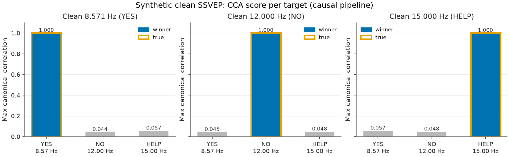
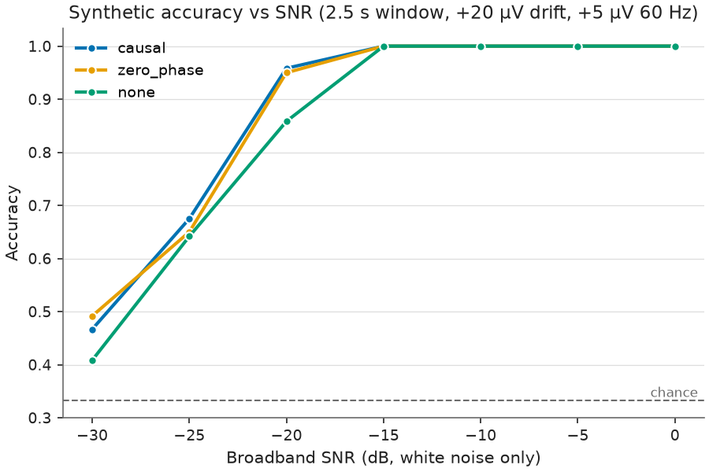
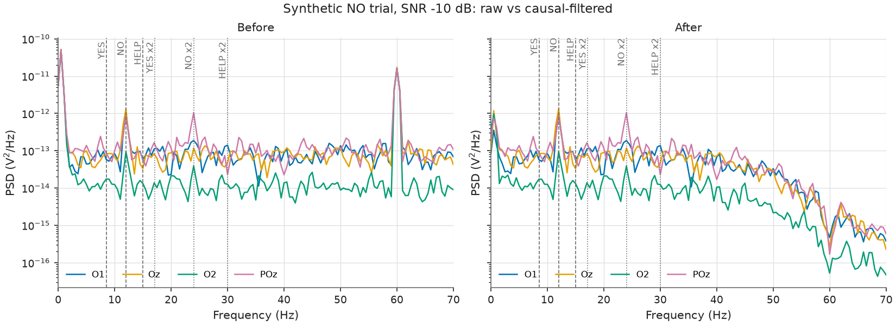
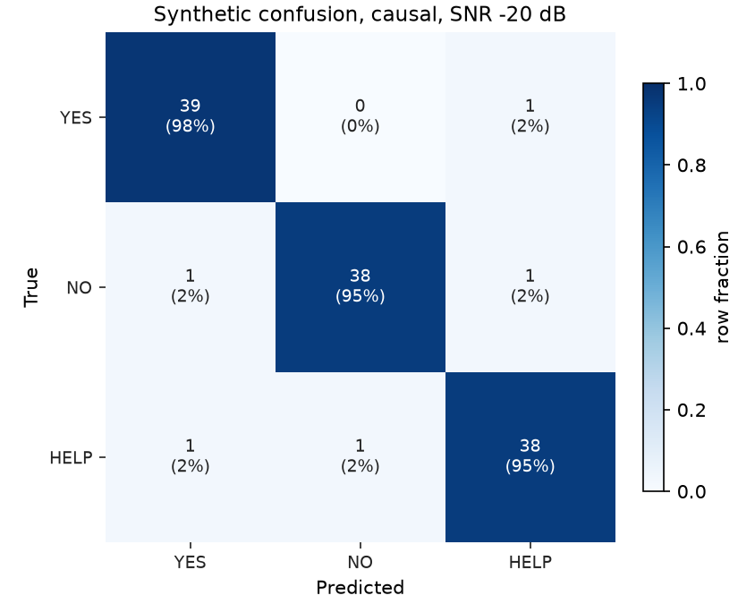
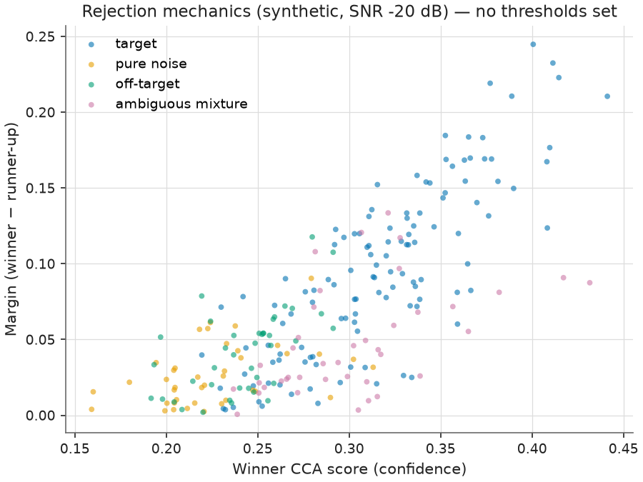
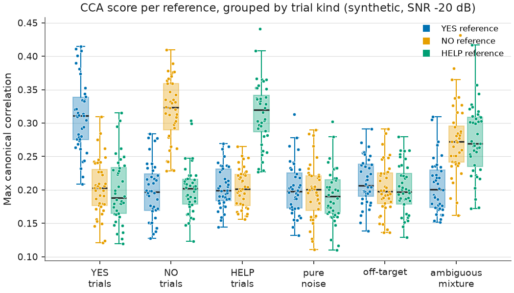

# Validation

What has been validated, how, and what remains. Evidence levels are kept separate: unit tests (code does what the docs say), synthetic validation (pipeline behaves sensibly), public benchmark (generic CCA works on real EEG), own-hardware validation (the only evidence that counts toward the SynapSys requirements).

Requirements (from `CLAUDE.md`): >= 85 % held-out own-system accuracy, <= 5 s end-to-end latency. Neither is evaluated yet.

## 1. Unit tests

`.venv/bin/pytest -q`: 190 passed, 1 skipped (the real-data benchmark test, skipped when `data/benchmark/` is absent). One test file per module:

| File | What is covered |
|---|---|
| `test_config.py` | project config loads; benchmark config keeps its extra `benchmark:` section; dict round trip; harmonics above Nyquist rejected; preprocessing validation; unquoted YES/NO labels rejected |
| `test_references.py` | shape/dtype, determinism, first-sample values, row values match the formula, FFT peak at each harmonic, bank equals individual sets, invalid inputs, above-Nyquist refused |
| `test_cca.py` | scores finite and in [0, 1]; exact linear combination scores 1; matched frequency wins; noise lowers score; invariance to channel permutation, per-channel scaling, DC offset; rank-deficient input (duplicate or zero channel); all-constant, non-finite and too-few-samples input raise `DegenerateSignalError`; cross-checks against the textbook covariance formulation and scikit-learn |
| `test_classifier.py` | clean synthetic classification; score order follows class order; margin and confidence; single-class margin; ungated vs gated behaviour, end-to-end rejection; tie-break by class order; invalid thresholds; label mismatch and NaN scores; config wrapper and channel-count/shape errors |
| `test_preprocessing.py` | SOS structure and row order; invalid design arguments; documented dB table, notch narrowness, group delay and settling times (asserted with tolerances); signal components pass/are removed, 60 Hz with and without notch; causality (output ignores future samples, zero_phase does not); causal DC policy equals `sosfilt_zi` initialisation; `StreamingFilter` equals offline causal; stage toggles; input validation; window extraction (sample-exact, bounds, last window) |
| `test_synthetic.py` | shape/units/labels, determinism, measured SNR matches the definition, clean peak and harmonic, drift and line frequencies, channel scaling, mixture, noise and off-target trials, metadata, invalid arguments |
| `test_metrics.py` | accuracy (REJECT counts as wrong), accepted accuracy, rejection rate, confusion matrix (with REJECT column, unknown labels raise), per-class accuracy, ITR known values, false-activation rate, empty inputs, JSON-serializable summary |
| `test_io_csv.py` | CSV/JSON round trip, unit conversion, channel selection, explicit args without sidecar, missing fs/units, non-monotonic time, missing file |
| `test_io_benchmark.py` | synthetic `.mat` fixtures: frequency lookup via `Freq_Phase` (not index), channel-name normalisation and selection, block selection, off-grid frequency error, no filtering and exact microvolt scaling, metadata, missing files, wrong shape. The real-S1 test is skipped without data |
| `test_pipeline.py` | noisy trial decoded for all classes; channel selection by name in config order; default last-window and explicit start; fs mismatch and missing channel raise; gating flows through the config; run artifacts saved; smoke tests of both scripts |
| `test_plotting.py` | the figure functions run and return figures |

Tests prove implementation consistency with the documented algorithm. They say nothing about EEG performance.

## 2. Synthetic validation (M6)

Command: `.venv/bin/python scripts/run_synthetic_validation.py` (defaults: `configs/synapsys.yaml`, 40 trials per class, seed 20261003, 6 s epochs). The decoder uses the **last 2.5 s** of each epoch, so the causal filter has 3.5 s of history (past its ~1-2 s start-up transient).

Disclaimer: synthetic signals do not model human EEG. These runs check pipeline behaviour (shapes, units, frequency selectivity, SNR trends, rejection mechanics). They are not performance claims and **no threshold was or may be selected from them**.

### Method

- Signal: sinusoid at the target frequency plus its 2nd harmonic, amplitude 1 uV, on O1/Oz/O2/POz with per-channel scaling.
- Noise: white Gaussian at a stated broadband SNR; additionally 20 uV slow drift and 5 uV 60 Hz line noise on all noisy trials (drift and line are NOT counted in the SNR).
- Conditions: clean; SNR sweep 0, -5, -10, -15, -20, -25, -30 dB; each SNR decoded with three preprocessing variants on identical trials (paired): `causal` (ESP32 path), `zero_phase` (offline reference), `none` (no DC removal, no filters, no notch).
- No gating (thresholds null) for the accuracy results.

### SNR definition

SNR_dB = 10 log10(P_signal / P_noise), where P_signal is the mean of x^2 over all channels and samples of the noise-free SSVEP component and P_noise is the white-noise variance. This is a **broadband** ratio: the noise is spread over 0-125 Hz, so the noise inside the ~1 Hz band around a target (and around a CCA reference) is far smaller. For fs = 250 Hz and 1 Hz resolution, narrowband SNR is roughly broadband SNR + 10 log10(125), about **+21 dB**. A broadband -20 dB corresponds to roughly +1 dB in the band of interest. Real EEG noise is coloured (1/f, alpha, artefacts), so these numbers do not transfer.

### Results (`docs/figures/synthetic/run.json`, run `20261003-231518_synthetic_validation`)

Clean synthetic trials, causal: 120/120 correct (accuracy 1.0, rejection rate 0, all scores finite; `n_nonfinite_scores` = 0).

Accuracy vs broadband SNR (120 trials per cell; chance = 33.3 %):

| SNR (dB) | causal | zero_phase | none |
|---|---|---|---|
| 0 | 100.0 % | 100.0 % | 100.0 % |
| -5 | 100.0 % | 100.0 % | 100.0 % |
| -10 | 100.0 % | 100.0 % | 100.0 % |
| -15 | 100.0 % | 100.0 % | 100.0 % |
| -20 | 95.8 % | 95.0 % | 85.8 % |
| -25 | 67.5 % | 65.0 % | 64.2 % |
| -30 | 46.7 % | 49.2 % | 40.8 % |

Confusion matrix, causal, SNR -20 dB (rows true YES/NO/HELP, columns predicted YES/NO/HELP):

| | YES | NO | HELP |
|---|---|---|---|
| YES | 39 | 0 | 1 |
| NO | 1 | 38 | 1 |
| HELP | 1 | 1 | 38 |

### Figures

`psd_before_after.png` is one synthetic trial at SNR -10 dB (raw vs causal-filtered).

### Interpretation

- **Frequency selectivity**: on clean trials the matched target wins every time, including 8.571 Hz versus 12 and 15 Hz.
- **SNR trend**: accuracy is flat at 100 % down to broadband -15 dB, then falls monotonically (-20: ~96 %, -25: ~67 %, -30: ~47 %, approaching chance of 33 %). This is the expected qualitative behaviour of CCA.
- **Preprocessing ablation**: with the drift (20 uV, 20x the SSVEP amplitude) and 60 Hz line noise present, the filtered paths are better than no preprocessing at -20 dB (95.8 / 95.0 % vs 85.8 %) and at -30 dB (46.7 / 49.2 % vs 40.8 %), with a smaller gap at -25 dB. Causal and zero-phase are within a few percentage points of each other in both directions (e.g. -30 dB: zero_phase higher; -20 dB: causal higher). With 120 trials per cell, one trial is 0.83 points; differences of this size, and the causal-vs-zero-phase ordering, are not established. The conclusion supported here is only that the causal path is not clearly worse than the offline reference on this synthetic data.
- **Rejection mechanics** (SNR -20 dB, 40 trials per class = 120 genuine target trials; 40 trials each of pure noise, an off-target SSVEP at 10.0 Hz or 20.5 Hz, and an ambiguous 50/50 NO+HELP mixture). Scores are CCA confidence and margin (median, p10-p90):

| Trial type | n | Confidence median (p10-p90) | Margin median (p10-p90) |
|---|---|---|---|
| Genuine target | 120 | 0.315 (0.255-0.376) | 0.091 (0.021-0.169) |
| Pure noise | 40 | 0.221 (0.199-0.280) | 0.023 (0.004-0.057) |
| Off-target | 40 | 0.247 (0.204-0.272) | 0.045 (0.010-0.071) |
| Ambiguous mixture | 40 | 0.301 (0.251-0.358) | 0.038 (0.014-0.098) |

  Qualitatively: genuine targets have the highest median confidence and margin; pure noise and off-target windows have lower confidence and a small margin; the ambiguous mixture has a confidence close to genuine targets but a margin much closer to the noise cases, i.e. margin gating is what separates it. The distributions overlap substantially (see `score_distributions.png`, `gating_scatter.png`), so any rejection rule will trade false accepts against false rejects. **No threshold was chosen from these data**, and none of these medians are to be used as thresholds: SNR here is arbitrary, the noise is white, and the human distributions will differ.

## 3. Public benchmark plan (M7-M8)

Script: `scripts/run_benchmark_validation.py --config configs/benchmark.yaml`. Requires `data/benchmark/` (see [../data/README.md](../data/README.md)); not run yet, no benchmark results exist.

**Dataset**: Y. Wang, X. Chen, X. Gao, S. Gao, "A Benchmark Dataset for SSVEP-Based Brain-Computer Interfaces," IEEE TNSRE 25(10), 2017. 35 subjects, 64 channels, 250 Hz, 40 targets (8.0-15.8 Hz in 0.2 Hz steps), 6 blocks. Each epoch is 1500 samples: 0.5 s pre-stimulus, 5 s stimulation, 0.5 s post.

**Purpose**: check that the generic CCA implementation, windowing and filtering recover the known stimulus frequency on real EEG. It does not validate SynapSys hardware or the YES/NO/HELP targets.

**Why 8, 12, 15 Hz instead of relabelling**: the dataset has no 8.571 Hz target, so there is no honest YES. Using the genuine 8.0, 12.0 and 15.0 Hz targets keeps frequencies real. Labels in `configs/benchmark.yaml` are `F8_0`, `F12_0`, `F15_0`; trials are never relabelled as YES/NO/HELP.

**Config differences from SynapSys**: the 60 Hz notch is off (`notch_hz: null`) because the recording was made on 50 Hz mains and the distributed data are already 50 Hz notch-filtered. Epoching comes from the `benchmark:` section: stimulus onset 0.5 s, visual latency 0.14 s, so the analysis window starts at 0.5 + 0.14 = **0.64 s** into the epoch (samples 160..785 for 2.5 s). Loaders do not filter, resample or crop.

**Causal-filter warm-up caveat**: the benchmark epoch is short, and filtering it causally from its first sample leaves a start-up transient of ~1-2 s (see algorithm.md, section 5). The window starting at 0.64 s overlaps that transient. The benchmark script therefore reports **both** `causal` and `zero_phase` results; a gap between them is partly a warm-up artefact of the epoch structure rather than a property of the on-device filter, which runs continuously. Both are filtered over the whole epoch before cropping.

**Experiments**:

| # | Experiment | Setting |
|---|---|---|
| 1 | 3-frequency smoke test | 8 / 12 / 15 Hz, O1/Oz/O2/POz, 2.5 s, 2 harmonics; subject 1 by default (`benchmark.subjects`) |
| 2 | Window-length sweep | 1.0, 1.5, 2.0, 2.5, 3.0 s |
| 3 | Channels | 4 channels vs 9 occipital/parieto-occipital (Pz, PO5, PO3, POz, PO4, PO6, O1, Oz, O2) |
| 4 | Harmonics | 1, 2, 3 |

Interpretation limits: different hardware, electrodes, montage, stimulus display, subjects and population; the result supports "the CCA implementation works", nothing more.

## 4. Threshold calibration plan

Applies to own-system data only. Thresholds stay `null` until this is done.

1. Collect a **development** set and a separate **held-out** test set (split by block/session, never by random window within a block). The development set must include **rest windows** (no stimulus attended) as well as the three targets.
2. On the development set, sweep a grid of (T, M) = (confidence threshold, margin threshold), including "off" for either, and tabulate per pair: total accuracy, accepted accuracy, rejection rate, and false-activation rate on rest windows.
3. Choose (T, M) by a rule fixed in advance (e.g. false-activation rate <= some bound, then maximise total accuracy), write the values to config, and **freeze** them.
4. Evaluate **once** on the held-out set. Do not retune after seeing held-out results; a further revision needs a new held-out set.

**Denominator of the 85 % requirement**: this must be stated explicitly in any report. `metrics.py` provides both:

| Metric | Definition | Effect of REJECT |
|---|---|---|
| `accuracy` (total) | correct / all trials | counts as wrong |
| `accepted_accuracy` | correct / non-REJECT trials (None if nothing accepted) | excluded |

Gating can always raise accepted accuracy by rejecting more; total accuracy is the stricter and the primary number, with the rejection rate reported next to accepted accuracy. Also available: per-class accuracy, confusion matrix with a REJECT column, Wolpaw ITR (`itr_bits_per_min`) and `false_activation_rate` on rest windows. Latency is reported with the window length used (<= 5 s end to end).

## 5. Own-hardware validation progression

Each step gates the next. Recordings use the CSV + JSON sidecar format (`io/csv_eeg.py`); `scripts/analyze_recording.py` gives the PSD before/after filtering and sliding-window CCA scores for each.

1. **Electronics test**: known input (e.g. a signal generator or shorted/test inputs) to confirm gain, units, sample rate, channel order, line pickup and noise floor.
2. **Alpha blocking**: eyes closed vs open should show a clear ~8-12 Hz power change at O1/Oz/O2, confirming real occipital EEG is being recorded.
3. **Single-frequency SSVEP**: one stimulus frequency at a time, check the spectral peak and CCA score at the correct target (and at the matching harmonic).
4. **Full 3-target protocol**: about **30 cued trials per command** (YES, NO, HELP) in blocks of ~10, order randomised, interleaved **rest trials**, with **calibration (development) data separate from evaluation data**. Then execute the threshold-calibration plan and the single held-out evaluation.

Any claim about the 85 % requirement comes only from step 4 on the held-out set.

## 6. Guardrails

- Standard CCA is not trained; never describe it as a model fit to data.
- Thresholds stay `null` until calibrated on own-system development data; never invented, never tuned on the final test set, never chosen from synthetic data.
- `zero_phase` is offline-only; the ESP32 path is `causal`, and offline evaluation filters the whole epoch causally and then crops.
- Benchmark trials are never relabelled as YES/NO/HELP; benchmark results validate generic CCA only and do not prove 85 %.
- The benchmark config disables the 60 Hz notch (50 Hz mains).
- Synthetic results are never quoted as human performance.
- Raw EEG stays out of git (`data/` is ignored).
- Every result run saves its config, run ID and per-trial predictions under `results/<run_id>/`; all synthetic code uses deterministic seeds.
